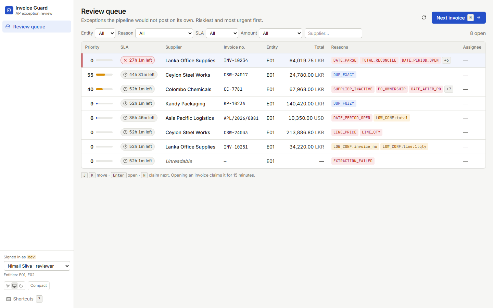
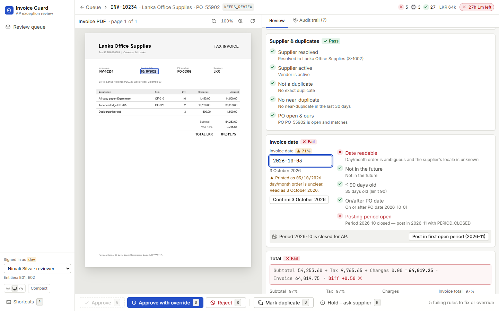
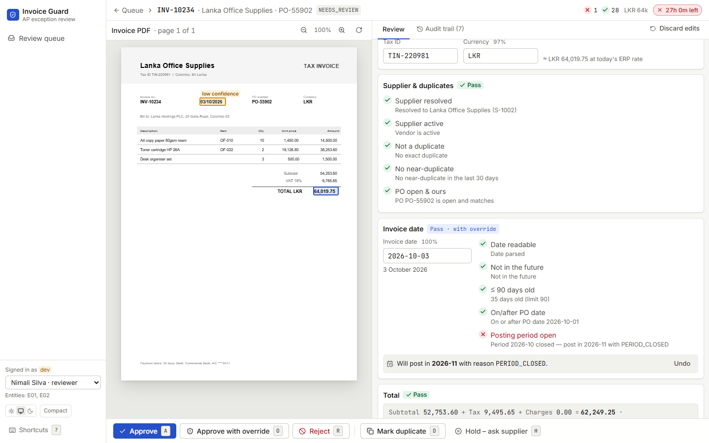
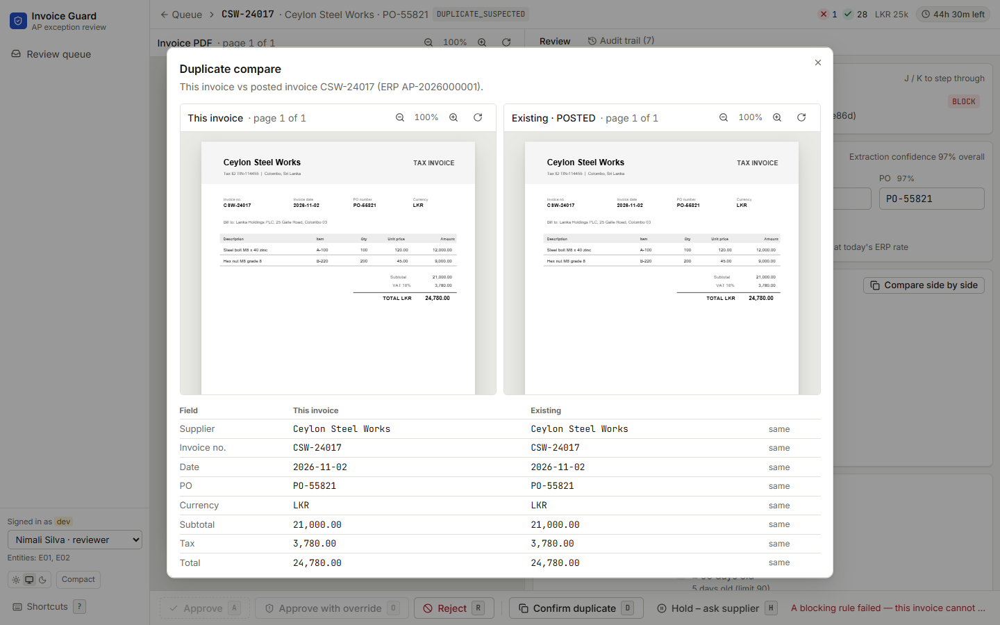
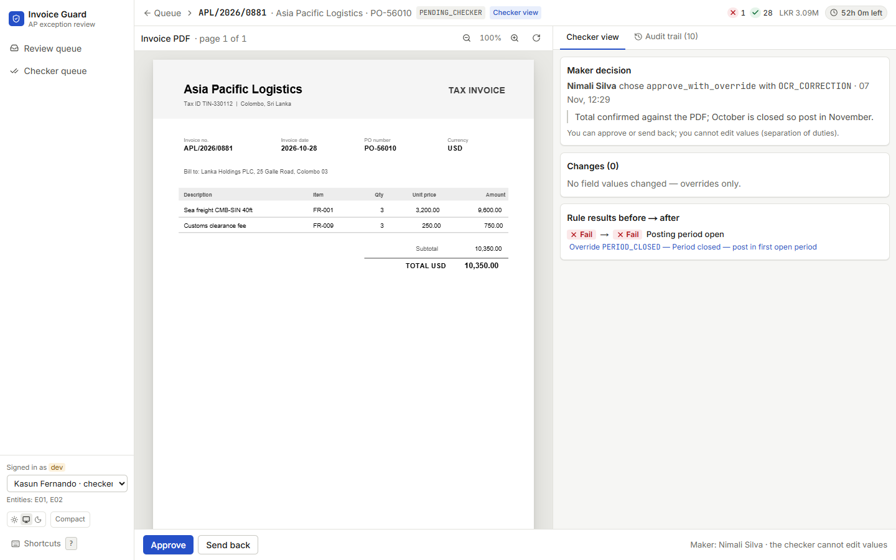
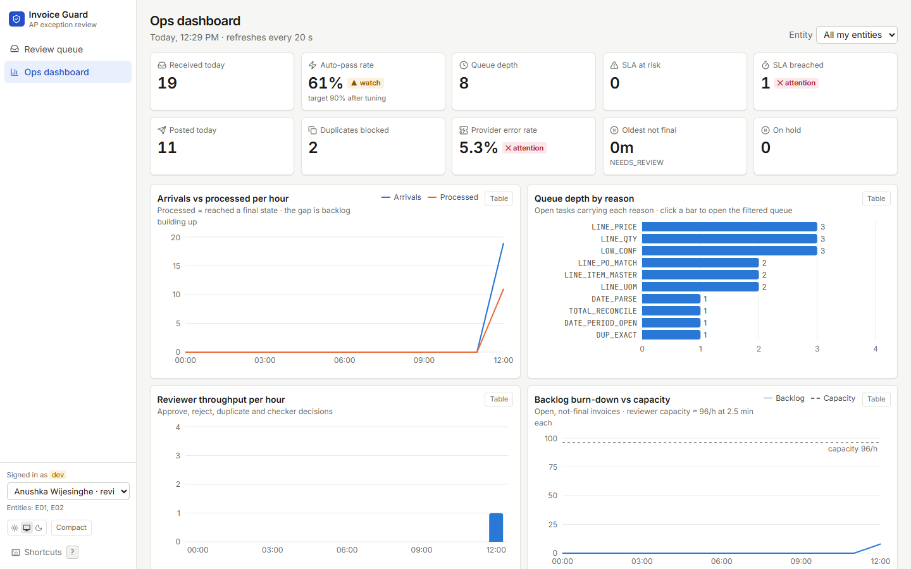
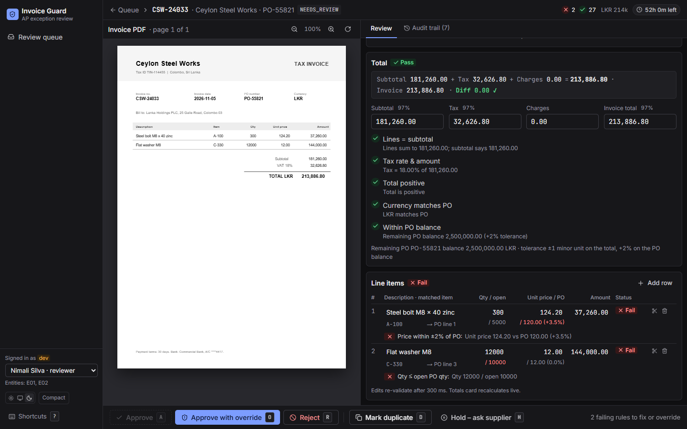

# invoice-guard

Supplier invoice PDF → **exactly one** ERP posting. A model only *reads* the invoice; a
deterministic rule engine decides whether it can post; anything uncertain goes to a person.
Built to the [Invoice Validation Pipeline TSD v2](docs/TSD_v2.pdf).

> **Status: Phase 1 (foundation).** State DB, inbox, rule engine, fake ERP, outbox relay,
> review API, review UI, SLA escalation and daily reconciliation, running on SQLite. Exercised
> end to end by 96 automated tests,
> a scripted walkthrough and a real-browser run of the UI.
> Wired but **not yet exercised against real systems**: the Kafka consumer, the Anthropic
> extractor (dev uses pre-recorded "sidecar" extractions) and Postgres (`SKIP LOCKED`).

---

## Screenshots

Captured from the demo data in a real Chrome (1440 × 900).

**Review queue** — breached SLAs pinned first, then by risk priority; reason chips say why
each invoice needs a person; "Next invoice" claims the top task for 15 minutes.



**Review workspace** — the TSD wireframe invoice. PDF evidence on the left: the selected
field's source box is outlined in the accent colour (low-confidence boxes are amber). On
the right, every failing rule is listed, in the order people fix them. Approve stays
disabled until each failure is fixed or overridden.



**After the reviewer's fixes** — date confirmed, unmatched line removed, total corrected,
closed period overridden with `PERIOD_CLOSED`. Each edit re-ran the same rules the pipeline
ran; the reconciliation strip now shows `Diff 0.00 ✓` and Approve is enabled.



**Duplicate compare** — a re-scan of an invoice already posted. Both PDFs side by side with
a field-by-field diff; `DUP_EXACT` blocks approval, so the choices are confirm or reject.



**Checker view** — an invoice above LKR 1M approved by Nimali waits for a second person.
Kasun sees the maker's reason, comment, changes and overrides, and can only approve or
send back.



**Ops dashboard** — KPI tiles with drill-down, arrivals vs processed, queue depth by
reason, reviewer throughput, backlog against capacity. Every chart has a table view.



**Dark theme, line items** — per-line PO match, quantity vs open PO quantity, price
variance against the PO, each failing rule explained under its line.



---

## Quick start (no Docker, no API key)

```bash
# 1. Python deps (Windows paths shown; on macOS/Linux use .venv/bin/...)
python -m venv .venv
.venv/Scripts/pip install -e ".[dev]"          # or: uv sync --all-extras

# 2. Demo data: runs the REAL pipeline (ingest → worker → rules → relay) on 19 generated PDFs
.venv/Scripts/python -m scripts.seed_demo

# 3. Processes, one terminal each
.venv/Scripts/python -m uvicorn services.api.main:app --port 8000   # review API → :8000/docs
.venv/Scripts/python -m services.relay.relay                        # posts approved invoices
.venv/Scripts/python -m services.scheduler                          # SLA + reconciliation, every 5 min
cd apps/web && npm install && npm run dev                            # review UI  → :3000
```

- Port 3000 taken? `npx next dev -p 3100` (the UI proxies `/api` to `:8000`, so any port works).
- Without the **relay**, approvals stop at `APPROVED_*`: the relay is the only thing allowed to
  talk to the ERP.
- The **worker** (`python -m services.worker.pipeline`) is only needed for *new* invoices; the
  seed already processed the demo ones.
- The **scheduler** escalates overdue reviews; the seed runs one pass so the demo queue already
  shows a warned, a breached and a twice-escalated invoice.
- No UI? `python -m scripts.walkthrough` narrates one invoice through every step in the terminal.

### Try it

The sidebar has a **dev identity switcher** (stand-in for SSO):

| User | Roles | Try |
|---|---|---|
| Nimali Silva | reviewer | Open **INV-10234** (the TSD wireframe): confirm the ambiguous date, fix the +0.50 total, pick a PO line for line 3 (or delete it), "Post in first open period", press **A** |
| Nimali Silva | reviewer | Approve **Asia Pacific Logistics** (USD ≈ LKR 3.1M) → it goes to a checker, not the ERP |
| Kasun Fernando | checker, reviewer | **Checker queue**: see the maker's diff, Approve or Send back |
| Janith Perera | reviewer (E01 only) | E02 invoices don't exist for him (404, not 403) |
| Anushka Wijesinghe | supervisor | **Ops dashboard**; tiles and bars drill into the queue |

Keyboard: **J/K** next/previous issue · **E** edit field · **A** approve · **O** override ·
**R** reject · **D** duplicate · **H** hold · **N** next invoice · **?** help.

Demo scenarios: auto-pass · wireframe invoice (ambiguous date, closed period, +0.50 diff,
unmatched line) · USD above LKR 1M · exact re-scan duplicate · near duplicate
(KP-1023 vs KP-1023A) · blocked vendor · price +3.5% and qty over PO · low confidence only ·
unreadable PDF → manual entry · Kafka redelivery · a message that never reached the inbox
(reconciliation catches it: **Ops dashboard → Daily reconciliation**).

---

## Design: what problem each piece solves

The TSD names two failures that matter most: **paying twice** and **not paying**. Every
choice below serves one of those or the "uncertain means human" rule.

### 1. Paying twice → three dedupe layers + an outbox

| Layer | Catches | Mechanism |
|---|---|---|
| Message | Kafka at-least-once redelivery | `inbox.message_id` primary key |
| File | Same PDF sent twice | `inbox.pdf_sha256` unique; object store is content-addressed, write-once |
| Business document | Same invoice re-scanned as a different file | Partial unique index on `business_key` (supplier, invoice no, date, total, currency) where state ≠ REJECTED |
| ERP edge | Crash between ERP accept and our DB update | Relay calls `find_by_external_ref(invoice_id)` **before every post** |

**Why an outbox:** approving and "remember to post" must be one atomic fact. The approval
transition and the `outbox` row commit in the same transaction; a separate relay drains it.
The relay is the only ERP writer, so there is exactly one place to reason about retries.
**Proof:** `test_relay_crash_after_erp_accept_posts_exactly_once` makes the fake ERP accept
then time out, retries, and asserts one ERP document and one `post_invoice` call.

**Colliding business keys are stored, not rejected:** the duplicate still gets an invoice row
(`business_key = NULL`, `duplicate_of = <holder>`) and goes to `DUPLICATE_SUSPECTED`, so a
person sees it in the compare view. Dropping it silently would be the "lost invoice" failure.

### 2. Not paying → state machine, commit per step, nothing silent

- The **state DB is the source of truth**; Kafka is only delivery. The offset is committed
  after the inbox row, so a crash before it means redelivery, never loss.
- An **explicit state machine** (`libs/db/state.py`) lists every legal transition. Each
  transition is one transaction, guarded by a `version` column (optimistic locking) and
  recorded as an **append-only, hash-chained event**, so "what happened?" always has an answer
  and tampering is detectable (`verify_chain`).
- Every worker step commits before the next starts; a 120 s lease plus a sweeper returns
  stuck work. Extraction that finally fails becomes a **manual-entry task**, not a dead letter.
- **Daily reconciliation** (`libs/core/reconcile.py`) is the net under all of that. At 23:30 in
  each entity's time zone it checks the day three ways: every message the channel delivered has
  an inbox row; every invoice POSTED that day has its ERP document; every pipeline ERP document
  has a POSTED invoice. The same pass flags duplicate ERP documents for one invoice (a double
  payment) and number or amount mismatches. Differences are stored, written to the invoice's
  audit trail, paged and shown on the ops dashboard; a source it can't read makes the run
  PARTIAL or ERROR, never a silent pass. Missed days (scheduler down) are caught up for a week.
  "What the channel delivered" must be read independently of the inbox: the Kafka topic in
  production, a ledger file the demo seed writes in dev (`MESSAGE_LEDGER=file|kafka|none`).

### 3. Uncertain means human → the model reads, code decides

- The LLM has **no tools and no posting rights**; its output is schema-only data (structured
  outputs) with a confidence and evidence (page + bbox + quoted text) per field. A field whose
  quoted text isn't in the PDF text layer gets confidence 0. Prompt-injection text in a PDF can
  at worst change *values*, which the rules then check.
- The **rule engine is a pure function** — `evaluate(invoice, context, rule_set)`, no I/O. That
  buys three things: it is unit-testable at the TSD's boundaries (exactly 90 days, ±1 minor
  unit, 2.0% vs 2.02%), replayable for audits, and **the review UI calls the same function**,
  so a reviewer sees exactly what the pipeline saw.
- Rules run in four stages (shape → identity → arithmetic → reference) and **never stop at the
  first failure**, so the reviewer sees every problem at once. A rule missing an input returns
  `SKIPPED` naming its dependency instead of guessing.
- **Money is integers in minor units** (ISO 4217 exponents; JPY 0, KWD 3) with `Decimal` +
  `ROUND_HALF_UP`. Floats never touch an amount.

### 4. Controls → enforced on the server, not in the UI

- Maker-checker at ≥ LKR 1M equivalent (ERP daily rate); `checker_id ≠ maker_id` checked in
  `libs/core/review.py`. The checker can approve or send back but cannot edit values.
- Approve requires: no BLOCK, no SKIPPED, and a valid reason code on every remaining FAIL
  (`OTHER` needs a 20-character comment). The server **re-runs the rules on approval** and
  refuses with 409 if results changed since the reviewer last looked (e.g. the PO was consumed).
- Entity scope is applied in the repository layer; out-of-scope invoices return **404** so
  their existence isn't revealed. Decisions need `If-Match: <version>`; a stale version → 409.
- **SLA escalation** (`libs/core/escalation.py`, run by `services.scheduler` every 5 minutes).
  The SLA clock counts business hours on the entity's calendar (8 h, or 4 h in the month-end
  window) and pauses while a task is on hold (max 3 business days, then it resumes on its own).
  Each level fires once, never twice:

  | SLA used | Level | Action | Notified |
  |---|---|---|---|
  | 75 % | 1 | Warn | Assignee + team lead |
  | 100 % | 2 | Breach: move to the supervisor pool; reviewers can't claim it (the current holder can finish) | Supervisors + assignee |
  | 150 % (125 % at month-end) | 3 | Second escalation | Finance manager + supervisors |

  Priority is recomputed on every pass, so the queue reflects time burning. Notifications are
  rows in `notification`, unique per (task, level) so a re-run or a second scheduler never sends
  twice; a pluggable sender delivers them (a log sender in dev) and retries up to 5 times.

### 5. Review UI → designed for a 2.5-minute exception

Reviewer time is the biggest cost (~31 FTE at month-end per the TSD), so the workspace is
built around speed and trust:

- **Evidence beside the claim:** PDF left (55%), fields right (45%). Clicking a field outlines
  its source box; clicking a box focuses the field. Low-confidence boxes are outlined amber.
- **Exceptions first**, ordered the way people fix them: identity → date → total → lines.
- **Live re-validation** 300 ms after each edit via `/validate` (nothing saved), with changes
  announced to screen readers (`aria-live`).
- **Status is never colour alone:** colour + icon + word (✓ Pass, ▲ Warn, ✕ Fail).
- **Numbers built for checking:** tabular numerals, right-aligned, currency code, signed diffs.
- **Every state designed:** loading skeletons, "Queue clear", claimed by someone else
  (read-only), stale data (draft kept), validate failed (Approve disabled), ERP down.
- Neutral surfaces with one accent; light/dark/system; compact density; chart colours checked
  with a colour-blindness validator in both themes.

---

## Problems found while building, and how they were solved

| Found by | Problem | Fix |
|---|---|---|
| Demo seed | `LINE_PRICE` compared a per-**bundle** price with the PO's per-**each** price (+2400%) | Convert to the PO's unit of measure via the item master before comparing |
| Browser run | Workspace crashed: Next's webpack re-bundling `pdfjs-dist` v5 throws `Object.defineProperty called on non-object` | Dropped `react-pdf`; PDF.js loads unbundled as a native ES module from `/public/pdfjs` |
| Browser run | Hydration mismatch on every page (identity lives in `localStorage`, which the server can't see) | App renders after mount |
| Browser run | A reviewer couldn't confirm an ambiguous date that was already right (no change → no correction sent) | "Confirm 3 October 2026" button; ISO date text input instead of the locale date picker, which itself showed `10/03/2026` |
| Screenshots | The whole page scrolled when a field got focus, pushing the header off screen: screen-reader-only (absolutely positioned) text inside the scrolling panel had no positioned ancestor and stretched the document | Scroll containers are `relative` and clip their overflow; the page itself never scrolls |
| Screenshots | A card still said "Fail" after its only failure was overridden, and a confirmed date still showed its 71% confidence | Card shows "Pass · with override"; confirmed or corrected fields show 100% |
| SQLite | SQLite drops `tzinfo`, breaking lease and SLA comparisons | `UTCDateTime` column type: always aware UTC in Python |
| SQLAlchemy | Replacing invoice lines hit `UNIQUE(invoice_id, line_no)` (inserts flush before deletes) | Flush deletes before re-inserting |
| Claude API | Forced `tool_choice` returns 400 on current models | Structured outputs (`messages.parse(output_format=…)`) |

---

## Decisions where the TSD is open

Written up in [`docs/README.md`](docs/README.md); in short:

- `DUP_EXACT` is BLOCK: confirm duplicate or reject. "Not a duplicate" applies to near
  duplicates, or after the reviewer corrects the business key.
- `SKIPPED` blocks approval and can't be overridden: you can't override a check that never ran.
- The pilot's auto-post ceiling (LKR 250k) is a setting (`auto_approve_ceiling_lkr_minor`),
  off by default. The TSD's open question about always reviewing ≥ LKR 10M uses the same knob.
- Non-PO invoices and credit notes stay exceptions until their own flows exist.

## Known gaps and risks (honest list)

| Gap | Impact | Next step |
|---|---|---|
| Dev header auth | Anyone can claim any identity | OIDC (Entra ID / Okta), roles + entities from group claims |
| No email/Teams sender | SLA notifications are recorded and logged, not delivered to inboxes | An SMTP or Graph `Notifier`; resolve `role:<role>@<entity>` from the directory |
| No holiday calendar | SLA business days skip weekends only | Per-entity holiday list in `libs/core/sla.py` |
| SQLite only tested | `SKIP LOCKED` and partial unique indexes untested on Postgres | Postgres in docker-compose + CI job |
| Real extraction untested | Sidecars stand in for the model | Run the eval set (500 labelled invoices) through `AnthropicExtractor` |
| Fake ERP doesn't consume PO balances | Repeat invoices against one PO keep passing `LINE_QTY` | Track invoiced qty, or read it from the real ERP |
| Token bucket is per process | Several workers could exceed provider limits | Redis-backed bucket |
| Kafka ledger untested | Reconciliation's channel check runs on the dev ledger file; `KafkaLedger` has not met a broker | Verify against the real topic in the shadow run |
| No pager integration | Reconciliation alerts are ERROR log lines | PagerDuty / Opsgenie `Pager` |
| No OCR, OpenTelemetry, S3/Blob, Playwright/axe CI | — | Phase 2–3 per the TSD rollout |
| Rule thresholds live in code | Changing one needs a deploy, not config-admin approval | Versioned rule sets per entity in the DB with a two-admin approval |

---

## Layout (TSD §10)
```
apps/web/          Next.js 15 UI: review queue, workspace, checker view, ops dashboard
services/ingest/   Kafka consumer → inbox (dedupe by message id + file hash)
services/worker/   extract → normalise → enrich → validate → route; lease sweeper
services/api/      FastAPI: queue, invoice, validate, decision, check, ops
services/relay/    outbox → ERP adapter (the only ERP writer)
services/scheduler/ every 5 min: SLA escalation; daily reconciliation after 23:30
libs/rules/        pure, versioned rule engine (no I/O)
libs/core/         normalisation, enrichment, routing, SLA, review workflow
libs/erp_adapter/  ERP protocol + fake ERP with fault injection
libs/llm_gateway/  structured-output extraction, token bucket, circuit breaker, fallback
libs/db/           SQLAlchemy models, state machine, audit chain, Alembic migrations
scripts/           seed_demo (real pipeline on generated PDFs), walkthrough
evals/             labelled invoices + scoring (Phase 2)
```

## Commands

| Task | Command |
|---|---|
| Lint + types + tests | `ruff check . && mypy && pytest -q` (or `make test` with `uv`) |
| Migrate a fresh DB | `alembic upgrade head` |
| Reseed demo data | `python -m scripts.seed_demo` (wipes `./data`) |
| Web checks | `cd apps/web && npm run lint && npm run typecheck && npm run build` |

The Makefile runs everything through `uv run`; without uv, use the commands in this table
from the activated `.venv`.
Set `ANTHROPIC_API_KEY` in `.env` to extract real PDFs (primary `claude-haiku-5-5`,
fallback `claude-sonnet-5-5`); with no key the worker uses the demo sidecars in `./data/sidecars`.
